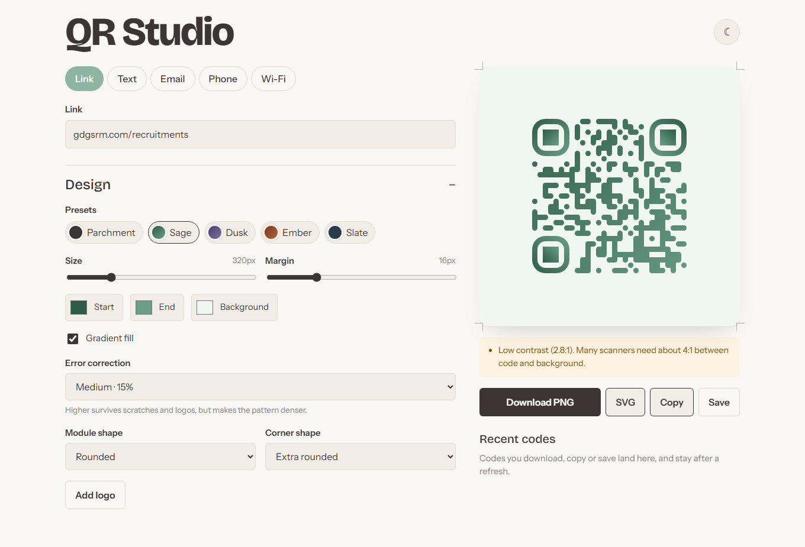
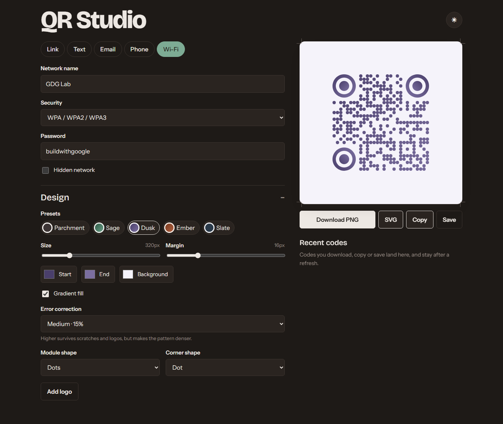
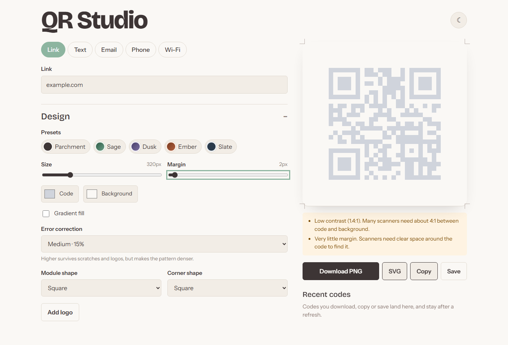
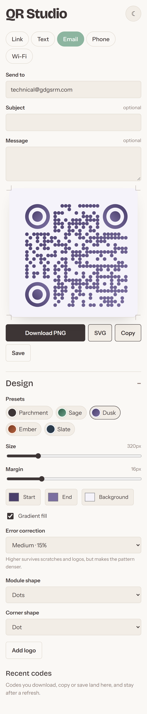
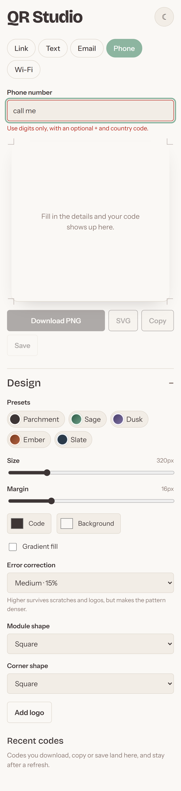

# QR Studio

Browser-only QR code generator and designer built for GDG on Campus SRM recruitments (Frontend Task 1). No backend required, client-side rendering with SVG/PNG exports and scan verification.

## Screenshots

| Desktop View | Wi-Fi Payload (Dark Mode) |
|---|---|
|  |  |

| Reliability Warnings | Mobile Responsive Layout | Validation Errors |
|---|---|---|
|  |  |  |

---

## Features

- **Multi-Type Payloads**:
  - URL (auto-prefixes `https://`, validates domains)
  - Plain Text (live character counter, 1200 char limit for scannability)
  - Email (`mailto:` formatting with subject and body params)
  - Phone Number (E.164 sanitization with optional international code)
  - Wi-Fi Network (`WIFI:T:WPA;S:...;P:...;;` syntax with escaping for special chars)
- **Real-Time Preview**:
  - Instant canvas updates as fields or styles change.
  - Scale-matched export canvas ensures downloaded PNG matches on-screen preview 1:1.
- **Deep Customization**:
  - Size control (120px to 1024px)
  - Margin / quiet zone padding (0px to 64px)
  - Foreground solid or 2-stop linear gradient
  - Background color picker
  - Error correction levels: Low (7%), Medium (15%), Quartile (25%), High (30%)
  - Module dot patterns: square, rounded, dots, classy, classy-rounded, extra-rounded
  - Corner eye square and dot shapes: square, extra-rounded, dot
  - Custom logo overlay support (auto-upgrades ECL to High)
- **Presets**:
  - 5 quick presets: Plain, Ink, Lagoon, Ember, Moss.
  - Full customization remains unlocked after selecting any preset.
- **Scan Reliability Engine**:
  - WCAG-style relative luminance contrast ratio calculation.
  - Warnings for contrast under 4:1, inverted codes (light on dark), margins under 8px, sub-160px size, or logo occlusion under low ECL.
- **Local History**:
  - Saves generated codes to `localStorage`.
  - Survives page reload; one-click restore into editor.
- **Export & Clipboard**:
  - Download as lossless PNG.
  - Download as scalable SVG.
  - Copy PNG directly to system clipboard via Async Clipboard API.
- **Theme**:
  - System-aware light/dark theme with manual toggle.

---

## Tech Stack

- **Framework**: React 19 + TypeScript + Vite
- **Styling**: Vanilla CSS with CSS custom properties (light/dark themes)
- **QR Engine**: `qr-code-styling`
- **Testing**: Vitest + JSDOM (unit/integration), Playwright + `jsqr` + `pngjs` (E2E scan verification)
- **Linter**: Oxlint

---

## Verification & Tests

The project includes unit tests for data encoding, contrast calculations, and persistence, plus end-to-end Playwright tests that download generated PNGs and decode them using `jsqr` to ensure every code scans back correctly.

### Run Unit Tests
```bash
npm test
```
Result: 44/44 tests passing across payload validators, style calculations, contrast metrics, and localStorage history.

### Run E2E Scan Verification
```bash
npx playwright test
```
Result: 20/20 browser tests passing. Verifies live downloads across all 5 data types, all 5 presets, preview-to-PNG pixel identity, history reuse after reload, error validation, and zero horizontal scroll overflow.

### Build & Lint
```bash
npm run lint
npm run build
```

---

## Local Setup

```bash
git clone <repo-url>
cd qr-studio
npm install
npm run dev
```

Open `http://localhost:5173` in your browser.
